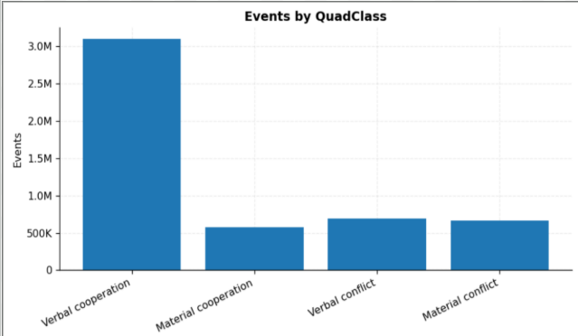
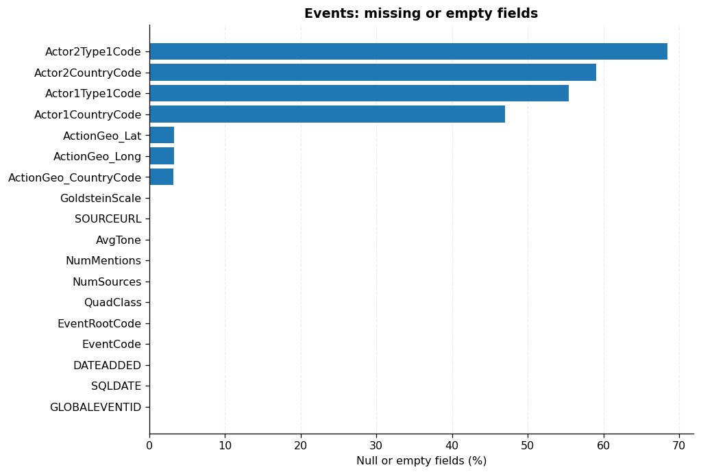
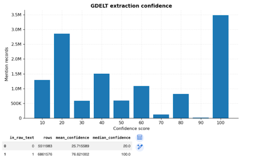
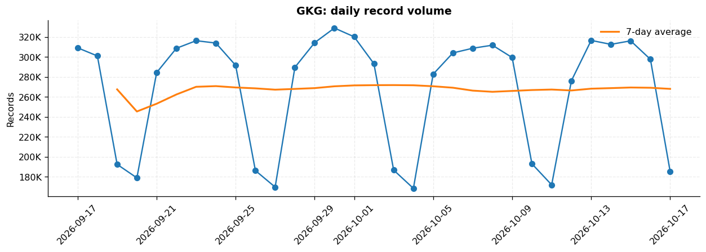
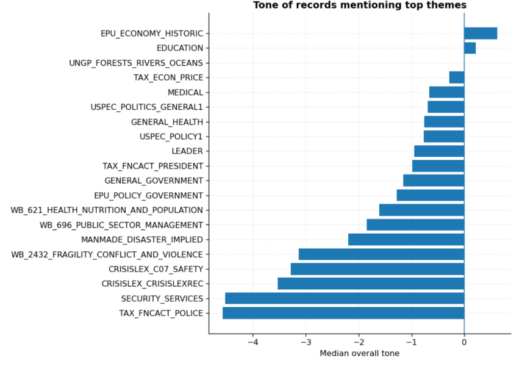
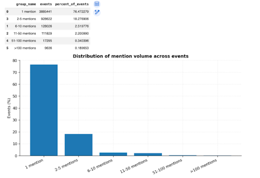
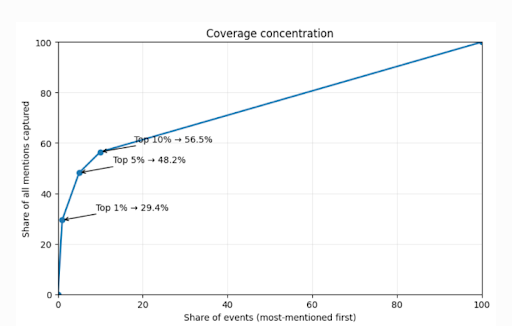
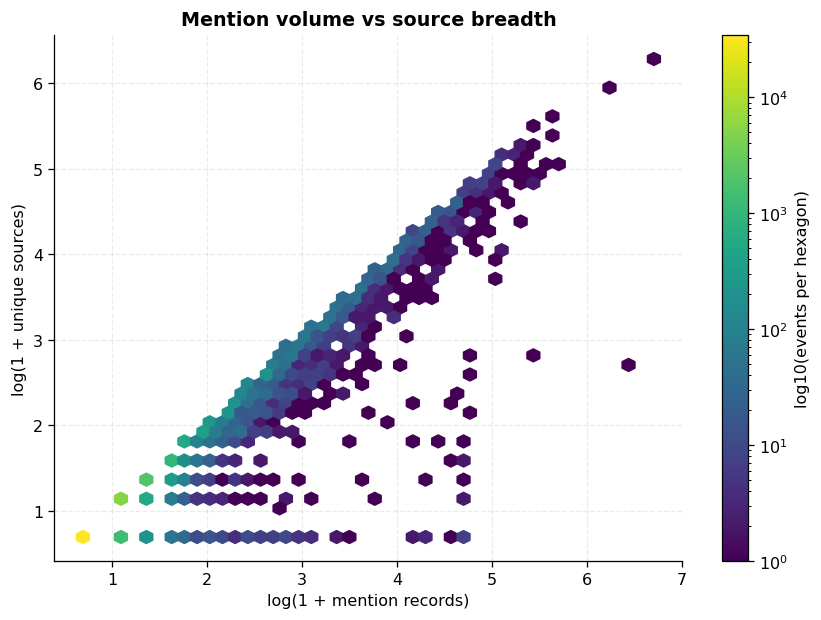

# The Attention Span of the World: Cleaning, Processing and Exploring 25.7 Million GDELT 2.0 Records

**EAS 587, Data Intensive Computing \| Project Phase 2 \| October 23, 2026** **Team:** JYP \| **Members:** Jake Rah, Prasansha Bharati, Yokibha Chapagain

---

## 1\. Executive Summary

How long does the world pay attention to a news story, and why do some stories come back? That is the question behind this project. We use GDELT 2.0, a huge database of news events. Events and Mentions are our main tables, and GKG is a smaller helper table that adds themes and tone. Our data runs from September 17 to October 18, 2026 (31 days) and holds 25.7 million records: 5,033,644 Events, 12,373,559 Mentions and 8,331,004 GKG records. Getting this data was harder than we expected. A local MongoDB store, small BigQuery downloads and pandas in Colab all failed, so we ended up with BigQuery exports in Google Drive, a Parquet and DuckDB workflow for early exploration, and a PySpark and Delta pipeline in Databricks. That pipeline flags problems but never deletes a row. Three results stand out. Coverage is very uneven: 76.47% of events get a single mention, while the top 10% of events collect 56.45% of all mentions. Coverage is also quick, with the median mention showing up 0.75 hours after the event is registered and 95% arriving within 17 hours. And GDELT's coding has clear limits, because event type, actor identity and tone each measure something different, and its verb-based coding sometimes gets the context wrong. Together these results tell us that attention has to be measured from the full Mentions table, and they shape the features we will build in Phase 3\.

---

## 2\. Connection to Phase 1

### 2.1 What Phase 2 is for

Phase 1 gave us a research problem and a plan. Phase 2 has one job: to understand the data. We profile it, build a clean and traceable version of it, and explore it enough to see which Phase 3 questions it can actually answer.

### 2.2 Change to the plan: dataset roles

We started Phase 1 thinking GKG would be our main dataset. We changed our minds once we looked closely at each table. Events tell us what happened (event type, actors, place). Mentions tell us when and how often it was covered, which is the heart of our project. So Events and Mentions are now primary, and GKG is secondary. It adds themes, document tone, source and translation details. The tables link through `Events.GLOBALEVENTID` to `Mentions.GLOBALEVENTID`, and through `Mentions.MentionIdentifier` to `GKG.DocumentIdentifier`. We can also compare `Events.SOURCEURL` with `GKG.DocumentIdentifier`.

### 2.3 Coding systems and dictionaries behind GDELT

GDELT turns raw news text into tables by running it through dictionaries and automated coders. That matters for us, because every column we use carries the assumptions of whatever system produced it.

Event coding starts with **CAMEO**, short for Conflict and Mediation Event Observations \[1\]. CAMEO is a list of political interactions arranged in three levels. The top level is `QuadClass`, which sorts events into verbal cooperation, material cooperation, verbal conflict and material conflict. Under it sits `EventRootCode`, with 20 two-digit categories such as 01 Make public statement, 04 Consult, 14 Protest and 19 Fight. At the bottom is `EventCode`, the detailed four-digit action. CAMEO also defines the actor type codes (GOV, MIL, BUS, CVL and so on) and the country, ethnic and religion codes used in the Actor columns. Every event type gets a **Goldstein Scale** score from \-10 (very conflictual) to \+10 (very cooperative). That score rates the kind of event. It says nothing about how serious the real event was.

The software that applies these codes comes from **TABARI**, which stands for Textual Analysis By Augmented Replacement Instructions \[2\]. TABARI is an open-source coder that matches patterns. It uses dictionaries of verbs, actors and phrases to pull out "who did what to whom" from a sentence. Because it matches words and sentence shape rather than meaning, it can misread context, and we show an example in Section 4.1. GDELT also tells us how much to trust each extraction. `Confidence` runs from 10 to 100, and `InRawText` is 1 when the event was found directly in the article text and 0 when GDELT had to rebuild it with more advanced language processing.

GKG adds a text layer. It tags each document with **themes** from several vocabularies, including World Bank topics (`WB_`), CrisisLex crisis categories (`CRISISLEX_`), UN Global Pulse topics (`UNGP_`) and US politics tags (`USPEC_`). Each theme is stored with its character position in `V2Themes`. It also scores the tone of each document using sentiment dictionaries, and packs the result into a seven-part `V2Tone` field. Finally, a machine-translation layer handles non-English sources, and we can see where translation happened in `MentionDocTranslationInfo` and in the GKG record identifier.

`[Please verify before submitting: the country code lists used by each column, and whether you want to name TABARI's successors.]`

### 2.4 Research questions (to be explored in Phase 3\)

Phase 2 builds the data and the measurements. These are the questions we will explore in Phase 3:

- Do more negative events receive more sustained coverage?  
- Do events covered by more independent sources persist longer?  
- Which themes produce flash attention, and which produce sustained attention?  
- Which themes repeatedly generate long-lasting attention?  
- Which U.S. events experience a second attention wave, seen as repeated activity in `MentionTimeDate`?  
- Do events involving government, business or other actor types behave differently?  
- Which U.S. events regain media attention after initially fading? We will compute `number_of_peaks`, `secondary_peak_size` and `time_between_peaks` at hourly resolution, then break the results down by `EventRootCode`, `V2Themes` and tone.  
- What causes an event to regain attention after fading?  
- Looking at trends over time, which stories come up again a while after the news first appeared (days or weeks later, not just hours), and what do these delayed returns have in common?

That last question is a little different from the two before it. Those look at renewed attention inside the normal coverage cycle. This one is about late returns, and a one-month window is too short to see many of them. It is one of the reasons we want to grow to at least six months of data.

**Our scope:** Mentions record media coverage, meaning what publishers wrote. They don't tell us whether anyone read, remembered or cared about a story.

---

## 3\. Data Cleaning and Processing

### 3.1 How we got the data

Our first plan was to download GDELT to our own machines and store it in MongoDB. It didn't work. We couldn't filter down to just the columns we needed, and our computers could only handle a few hours of data. Next we tried BigQuery, which is what GDELT recommends. The catch was that downloading a result as CSV gave us only about 10 MB at a time. Saving query results to Google Drive fixed that, since Drive allowed files of roughly 1 GB. Even so, we had to query in chunks to stay under that limit. In the end we exported one month of each table, from September 17 to October 18 (exclusive). The landing folder held 23 CSV files. Two were duplicate copies, so we left them out and kept 21 (4 Events, 4 Mentions, 13 GKG).

With the files in Drive, we did our first round of analysis in Google Colab. We used three notebooks, one for each table: `GDELT_Events_Preliminary_LocalParquet.ipynb`, `GDELT_Mentions_Preliminary_LocalParquet.ipynb` and `GDELT_GKG_Preliminary_LocalParquet.ipynb`. After that we moved to Databricks. We built the ETL pipeline on a 12-hour slice first, ran it on the full month once it worked, and ran our EDA on the processed output.

We exported only the columns we need:

- **Events (18):** `GLOBALEVENTID, SQLDATE, DATEADDED, EventCode, EventRootCode, QuadClass, GoldsteinScale, Actor1CountryCode, Actor2CountryCode, Actor1Type1Code, Actor2Type1Code, ActionGeo_CountryCode, ActionGeo_Lat, ActionGeo_Long, NumMentions, NumSources, AvgTone, SOURCEURL`  
- **Mentions (11):** `GLOBALEVENTID, EventTimeDate, MentionTimeDate, MentionType, MentionSourceName, MentionIdentifier, Confidence, InRawText, MentionDocLen, MentionDocTone, MentionDocTranslationInfo`  
- **GKG (6):** `GKGRECORDID, DATE, SourceCommonName, DocumentIdentifier, V2Themes (or Themes), V2Tone`

### 3.2 Profiling

Before cleaning anything, we profiled each table. We counted rows, nulls and empty strings, estimated distinct values, checked for parse failures and out-of-range values, tested whether IDs were unique, and compared the 15-minute time slots we expected with the ones we found. Approximate distinct counts were used only for quick looks. Whenever an ID or duplicate decision was at stake, we used exact counts.

The Silver layer ended up with the same number of rows as the input: 5,033,644 Events (61 columns), 12,373,559 Mentions (46 columns) and 8,331,004 GKG records (56 columns). **We removed zero rows.** Compression helped a lot, too. Raw CSVs of 1.01, 2.54 and 11.25 GB (Events, Mentions, GKG) became 0.28, 0.48 and 2.25 GB as compressed Parquet.

### 3.3 Pipeline: Bronze, Silver, validation

The pipeline has three notebooks.

- **Bronze** (inspection): checks the file list, column layouts, row counts, date ranges and file copies. It stores values exactly as exported and adds two provenance columns, the source file and a coverage status.  
- **Silver** (transformation): keeps every original column and adds cleaner versions plus quality flags. For Events, it validates IDs, parses dates and times, converts numbers, checks coordinates and flags missing values. For Mentions, it parses timestamps, converts confidence, tone and length to numbers, and flags mentions that appear before their event or repeat exactly. For GKG, it validates IDs and timestamps and splits `V2Tone` into seven numbers (`tone_parsed, positive_score, negative_score, polarity, activity_reference_density, self_group_reference_density, word_count_parsed`). It also breaks `V2Themes` into `theme_mentions` (theme and position pairs), `themes` (distinct names), `theme_mention_count`, `distinct_theme_count` and `invalid_theme_entries`, and keeps the original string.  
- **Validation:** checks row counts, schemas, missing values, flag summaries, time coverage, the Events-to-Mentions link, and reads the saved Delta tables and reports back to make sure they are saved properly.

### 3.4 Cleaning decisions and quality flags

Our rule was simple: flag problems, don't delete rows. If we filled in or dropped country affiliations, themes or coordinates, we could end up adding information nobody actually observed. And a record with a missing optional field is still a useful record. So we counted the problems and kept the rows. We found 858 Events with incomplete coordinate pairs, 2,788 Mentions (about 0.023%) seen before their event was registered, 386,257 Mentions in groups of identical exported values, 526,400 GKG rows involved in source-ID conflicts, 743,205 GKG rows (8.92%) with no themes, and 115,798 Mentions (0.94%) that didn't match any Event. These groups overlap, so you can't add them up. Each analysis uses only the flags that matter for its own fields.

- **Duplicates.** Every one of the 5,033,644 `GLOBALEVENTID` values is distinct. GKG is messier. It has 8,067,804 distinct record IDs, which means 263,200 IDs are repeated, and in every repeated group the content differs. A keep-first rule would throw away real information. Mentions have their own problems. The export leaves out sentence IDs and character offsets, so two identical rows might be two separate mentions inside one long article. Because of this, each analysis has to say what it is counting (exported rows, distinct URLs or event-document pairs).  
- **Missing values.** We didn't impute anything. Missing actor country, translation info and themes follow patterns. They aren't random gaps.  
- **Outliers.** We kept them. Long documents (over 10,390.5 characters, about 5.5% of Mentions) and high-mention events are exactly what we want to study.  
- **Types and text.** CAMEO codes stay as text so leading zeros survive. Blank names and URLs turn into null only in the derived columns.  
- **Time coverage.** All 31 Event dates and all 2,976 expected Mentions intervals are there. GKG has 2,975 of 2,976. The missing slot is **September 17, 2026 at 13:00 UTC**. The slot before it (12:45) has 4,769 rows and the one after (13:15) has 1,345. We checked BigQuery and the gap is in the source, and we couldn't find any GDELT notice that explains it. We treat it as missing data, not a quiet news hour, and we added no made-up rows.  
- **Linking tables.** 12,257,761 of 12,373,559 Mentions rows (99.06%) match an Event. The 115,798 that don't match all have registration times inside our window, so references to events outside the window can't be the whole explanation. Events and GKG share 1,320,627 distinct URLs. That is a useful link, but sharing a URL doesn't prove two records describe the same event.

### 3.5 Scalable processing and runtime

We never loaded the full data into memory. In Colab, DuckDB read the Drive CSVs once, we kept only the selected fields, and we wrote them out as compressed Parquet. Queries ran under a 3 GB memory limit with 2 threads and could spill to disk. Only summaries and fixed, hash-based samples went to pandas. In Databricks, PySpark did the heavy work (aggregations, window functions and joins) on Delta tables, and only small aggregated results came back to the driver. The Silver tables for Events, Mentions and GKG sit in the `workspace.gdelt` schema. The quality report and the list of unmatched Mentions are in the workspace volume. We executed the pipeline on Databricks Free Edition utilizing serverless computing. Initially, we evaluated the Bronze, Silver, and validation workflows using a 12-hour pilot dataset prior to expanding to the complete 31-day dataset. The complete pipeline efficiently handled 25,738,207 records from Events, Mentions, and GKG while maintaining all input rows. While we did not track precise execution times or maximum memory consumption, the successful month-long execution showed that our PySpark and Delta Lake workflow effectively processed the dataset within the existing computing environment.

---

## 4\. Exploratory Data Analysis

We followed Tukey's approach to exploration, as the assignment asks. In plain terms, that means we looked at graphs first, used log scales for skewed data, leaned on medians and IQR instead of averages, checked residuals where we fit anything, and watched for surprises. Counts come from the full data. We used fixed samples only for expensive plots and for unpacking themes.

### 4.1 Events: what was coded

**Event type.** Verbal cooperation makes up 61.50% of events (3,095,898). Verbal conflict is next at 13.74%, then material conflict at 13.25% and material cooperation at 11.51%. The most common root codes are 04 Consult (1,256,629), 01 Public statement (687,924), 05 Diplomatic cooperation (446,679), 02 Appeal (395,882) and 11 Disapprove (321,311). That made sense to us as talking is cheap, and the news is full of meetings and statements. Among conflict types, Disapprove (11), Fight (19) and Coerce (17) are biggest at about 0.2 to 0.3 million events each. Protest (14), Exhibit force (15) and Mass violence (20) are small. Some rare codes may be too small for lifespan analysis or clustering, so in Phase 3 we will merge or drop them.

.jpeg)

**Figure 1. Share of Events by CAMEO root category.**
Consult is the biggest category at 1,256,629 events (24.96%), followed by Make Public Statement (13.67%) and Diplomatic Cooperation (8.87%). Talk-related codes dominate, while Unconventional Mass Violence has only 2,316 events (0.05%), so rare codes will need merging before any lifespan modeling.

**Figure 2.Events by QuadClass.**
Verbal cooperation is about 3.1 million events, far above the other three classes at roughly 0.6 to 0.7 million each. Material cooperation, verbal conflict and material conflict are close to each other in size.

**Tone versus type.** The median initial `AvgTone` is \-1.79 (Q1 \-4.45, Q3 0.75). That is mildly negative, even though most events are cooperative. Tone gets steadily more negative as we move from verbal cooperation to material conflict. So event type and tone are linked, but they aren't the same thing.

**A coding mistake.** Goldstein scores have a median of 1.0 (Q1 \-2.0, Q3 3.4). While reading through the data we found a clear failure. A headline about a cartel boss running a drug-trafficking group was coded under root code 07 ("Provide aid"), and it received a Goldstein score of **\+7.0**. CAMEO maps verbs, not context, so an illegal criminal enterprise came out looking strongly cooperative \[1\], \[2\]. We now treat Goldstein scores with caution. They describe the type of event and nothing more.

**Missing data has a pattern.** Event location country is missing in only 3.16% of rows (latitude 3.27%, longitude 3.25%). Actor fields are a different story. Actor 1 country is missing 46.97% of the time, Actor 2 country 59.01%, Actor 1 type 55.38% and Actor 2 type 68.47%. In other words, GDELT often knows where something happened even when it can't tell who was involved. We can't treat those actor gaps as random. The top three countries are the USA, Russia and India. `[State whether this is by action location or actor country.]`

**Figure 3. Percent of null or empty values in each Events column.**
Core event fields are essentially complete and location country is missing only about 3% of the time. Actor fields are missing in roughly half of rows or more (Actor 2 type 68.47%, Actor 2 country 59.01%, Actor 1 type 55.38%, Actor 1 country 46.97%), so any actor-based analysis has to report this gap.

**Timing and repeated URLs.** Most events are uploaded the same day they happen. The Event files overlap in their `DATEADDED` ranges, but no `GLOBALEVENTID` shows up in more than one file, so we query them as a single dataset. The busiest day is September 23, with 204,997 events. October 18 and 19 are partial days at the edge. We also found 1,439,507 distinct `SOURCEURL` values. Of these, 878,682 repeat, and each repeated URL belongs to several event IDs (the biggest one appears in 475 events). That isn't a duplicate problem. One article can describe many events.

### 4.2 Mentions: how events were covered

**Completeness and translation.** Core Mentions fields are almost complete, with only 3 to 5 nulls among 12.37 million rows. `MentionDocTranslationInfo` is blank in 8,716,336 rows (70.44%), which looks bad at first. It isn't. The field records machine translation, so a blank means the article was originally English or was translated by a person. The right way to read it is that **29.56% of mentions (3,657,223) carry machine-translation info**.

**Sources.** Only two `MentionType` values appear, and type 2 shows up just 5 times. The biggest sources by volume are iheart.com (412,280), indiatimes.com (84,534), zazoom.it (50,254), dailymail.com (49,503) and jpost.com (47,620). These numbers tell us how much a source publishes. They don't tell us how many people read it.

**Extraction confidence.** Direct raw-text matches (`InRawText` \= 1, 6,861,576 rows) have a mean confidence of 76.62 and a median of 100\. Reconstructed matches (`InRawText` \= 0, 5,511,983 rows) have a mean of 25.72 and a median of 20\. This is what the codebook says should happen, so it is a handy internal quality check.

**Figure 4. Distribution of GDELT extraction confidence scores across Mentions.**
Scores pile up at 100 (about 3.49 million mentions) and 20 (about 2.86 million), with almost nothing at 90. Direct text matches have a median of 100 and reconstructed ones a median of 20, so confidence follows the extraction method and can work as a quality filter.

**Document length.** `MentionDocLen` runs from 37 to 532,747 characters. Even after a log transform it stays heavily right-skewed. The IQR rule (Q3 \+ 1.5 × IQR \= 10,390.5 characters) flags about 679,098 rows, or 5.49%. They are all on the high side, since the lower fence is negative. We kept them. Long investigations, transcripts, live blogs and roundups are real documents, not errors.

### 4.3 GKG: document context

**Volume.** A normal full day holds roughly 170K to 330K records, and the busiest was September 30 with 328,967. Weekdays are busier than weekends, and activity climbs through the UTC morning to a peak around midday. That is a publishing rhythm, and we don't read it as a cause of anything. The September 17 13:00 gap is easy to spot next to its neighbors.

**Figure 5. GKG records per day with 7-day rolling average.**
Daily volume swings between roughly 170K and 330K on a weekly cycle, with sharp weekend dips. The 7-day average stays near 270K, so the rhythm comes from publishing habits and not from a trend.

**Tone.** `V2Tone` is clean. All 8,331,004 rows have exactly seven parts, and none failed to parse. Overall tone has a median of \-0.45, a mean of \-0.77, quartiles of \-3.17 and 1.80, and a 95th percentile of 5.33. Word count has a median of 335 and a 95th percentile of 1,109. Overall tone moves opposite to the negative score (Spearman \-0.854) and with the positive score (0.697). No surprise there, because all seven numbers describe the same text. They are not independent features. `[Add medians for positive, negative, polarity and activity from your own Silver-table plots; the placeholder charts in Findings should not be used.]`

**Themes.** Most records that have themes have a lot of them. In a fixed sample of about 750,000 records, the most common themes are `UNGP_FORESTS_RIVERS_OCEANS` (35.3%), `CRISISLEX_CRISISLEXREC` (32.7%), `WB_696_PUBLIC_SECTOR_MANAGEMENT` (26.0%) and `USPEC_POLITICS_GENERAL1` (24.2%). Tone is lowest for justice and safety themes: `WB_840_JUSTICE` is about \-3.3, `CRISISLEX_C07_SAFETY` about \-3.1 and `CRISISLEX_CRISISLEXREC` about \-3.0. We have to be careful here. A negative average doesn't mean the theme causes the negative tone. Theme names are also taxonomy codes, so we will translate them into plain topics before using them in Phase 3\. One more thing to remember: 64.23% of GKG records (5,350,638) are machine-translated, so most of this tone and theme data comes from translated text.

**Figure 6. Top 20 themes and mean tone.**
The figure shows that most frequently mentioned themes have a negative median tone, particularly policing (−4.62), security services (−4.57), and crisis-related topics. In contrast, education and historical economic themes show slightly positive tones. This suggests that news sentiment varies by topic, with conflict and security coverage tending to be more negative. However, further analysis is needed to determine whether negative tone influences how long an event receives media attention.

---

## 5\. First Analytics Results

### 5.1 Attention is extremely concentrated

Mentions contains 5,080,849 distinct event IDs. Of these, 3,885,441 (76.47%) have exactly one mention. Another 18.28% have 2 to 5, 2.52% have 6 to 10, 2.20% have 11 to 50 and 0.34% have 51 to 100\. Only 0.19% (9,636 events) have more than 100\. The top 1% of events hold 29.38% of all mentions. The top 5% hold 48.16%, and the top 10% hold 56.45%. A small group of events gets most of the coverage, and everything else gets almost none. Because of this, we will work with log mention counts and compare groups using medians and quantiles. Averages would mislead us. This result is our starting point for asking whether negative tone, source diversity and themes are linked to more sustained coverage.

**Figure 7(a). Distribution of mention volume across events.**
76.47% of events have exactly one mention and only 0.19% have more than 100. A typical event gets almost no coverage, so averages describe it poorly.

**Figure 7(b). Share of all mentions captured by the most-mentioned events.**
The top 1% of events hold 29.4% of mentions, the top 5% hold 48.2% and the top 10% hold 56.5%. The curve rises steeply at the start, which shows how much attention sits in a small group of events.

### 5.2 Coverage is fast, with a very thin late tail

We define story age as `MentionTimeDate` minus `EventTimeDate`. The median story age is 0.75 hours. The 75th percentile is 4.75 hours, the 95th is 17 hours and the 99th is 21.75 hours. By time bucket, 51.42% of mentions arrive within the first hour, 26.33% between 1 and 6 hours, 10.53% between 6 and 12 hours and 11.54% between 12 and 24 hours. After that it nearly stops. Only about 0.17% of mentions come after a full day (0.05% at 1 to 2 days, 0.03% at 3 to 7 days and 0.09% after 7 days). Most events are over within a day. This makes late mentions rare, and that is exactly why they are valuable. They are the best clue we have about second waves, resurgence and delayed returns. We found 2,788 mentions with a negative age. We flagged them and kept them. `EventTimeDate` records when GDELT first saw the event, which isn't always when it happened.

### 5.3 Volume is not the same as diversity

A lot of mentions doesn't always mean a lot of different sources. One outlet can mention the same event again and again. So we track mentions, distinct sources and distinct documents separately. The `NumSources` field in Events won't help us here, since its median and 95th percentile are both 1 in the initial window. We calculate breadth from the full Mentions table instead. This gives us what we need to test whether events covered by more independent sources last longer. `[Add the result of the hexbin plot of log mentions against log distinct sources and the correlation.]`

**Figure 8. Mention volume versus source breadth per event (log scale, 50,000-event sample).**
Most events sit in the bottom-left corner: one mention from one source (median 1 and 1, 95th percentile 9 mentions and 8 sources). Points near the diagonal show events whose volume comes with more sources, and points well below it show many mentions from few sources, which suggests repetition.

### 5.4 What this sets up for Phase 3

From the Mentions table we will build features for each event: early volume (first two hours), peak height, time to peak, source breadth, observed duration, decay and half-life. For the resurgence questions we will also count peaks and measure the gaps between them. There is one catch. We measure duration from the first and last mention inside our window, so events near either edge get cut off. An event that starts on the last day may look short-lived only because our data stops. To handle this we need buffers around the edges, or survival curves, a method that estimates how long events last even when we can't see some of them end. The question about delayed returns needs more than a month of data too, which is why scaling to six months is a priority for Phase 3\.

---

## 6\. Dead Ends

1. **Local download and MongoDB.** It seemed like the natural choice, but it failed. We couldn't pick out only the columns we needed, and our computers handled only a few hours of data. The lesson was to filter at the source before downloading anything.  
2. **Direct BigQuery CSV download.** The 10 MB cap made a full month impossible. Sending results to Drive (about 1 GB per file) worked, but it forced us to query in chunks and left us with a manual step. That step is now our biggest reproducibility gap.  
3. **pandas in Colab.** The 11.25 GB GKG export used up all of Colab's RAM and crashed the kernel. Even the smaller tables were slow. Compressed Parquet with DuckDB, and later Spark, solved it. We learned to keep large grouped calculations out of pandas.  
4. **Loading columns with native types.** This slowed ingestion and hid errors. Reading everything as text and converting during validation let us count nulls, empty values and failed conversions separately.

---

## 7\. Design Decisions

**Table roles and acquisition.** We began with GKG as our main dataset, then switched to Events and Mentions, because the timing and volume of coverage that our research depends on live in Mentions. GKG became the enrichment layer for themes and tone. For getting the data, we looked at downloading locally and at exporting directly from BigQuery as CSV. We picked BigQuery exports saved to Drive in chunks, since this let us choose only the columns we needed and gave us files of up to about 1 GB.

**Processing engine and storage.** We considered chunked pandas and MongoDB. We chose DuckDB with Parquet for early analysis, then PySpark with Delta tables in Databricks for scale and reuse. Compressed Parquet and Delta cut the data size by about 80% (roughly 14.8 GB down to 3.0 GB), and repeated scans got much faster than reading CSV. We also read every column as text first and converted types only during validation. That way we could count nulls, empty strings and failed conversions separately instead of losing them quietly.

**Missing values, duplicates and outliers.** Here we looked at mean or median imputation, `drop_duplicates` with keep-first, and IQR or z-score trimming. We chose to flag and keep in every case. Missing actor country, translation info and themes follow patterns, so filling them in would mean inventing data. The Mentions export has no sentence or character-offset fields, and repeated GKG record IDs carry conflicting content, so deleting duplicates could remove real records. Long documents and high-mention events are what we study, so trimming them would remove the signal. For similar reasons, we state a counting unit for each analysis (rows, distinct URLs or event-document pairs) instead of using one fixed rule.

**Re-expression, summaries and sampling.** Mention counts and document lengths are heavily skewed. We used log scales, and we reported medians, IQR and percentiles in place of means and standard deviations. For costly plots and theme expansion we used fixed hash-based samples instead of random ones. That makes plots repeatable, and all headline counts still come from the full data. CAMEO codes stay as text to keep their leading zeros.

**The missing GKG interval.** We could have filled the gap on September 17 by interpolating. We decided to leave it as missing, with no zeros and no made-up rows, so nobody mistakes it for a real drop in news.

---

## 8\. Reproducibility Statement

We verified that our processing pipeline reproduces the Phase 2 results. The cleaning and transformation steps (Bronze inspection, Silver transformation and validation) run in Databricks on PySpark and Delta tables. They don't depend on one person's laptop, installed libraries or memory, so the same notebooks run the same way on any system that can reach the workspace. We built and tested the pipeline on a 12-hour slice, then ran it unchanged on the full month. The saved Silver tables and quality report passed read-back checks. Our samples for plots are deterministic, so figures and sample-based numbers come out the same every time.

One step is still manual: BigQuery results are exported to Drive before they enter Databricks.

**Planned next steps:** make the pipeline pull straight from GDELT/BigQuery inside Databricks so Drive is no longer needed; grow from one month to at least six months; build the event-level trajectory features with edge buffers; resolve repeated GKG IDs and clean URLs for the Mentions-to-GKG join; group related coverage into research events and check our classification into technology, science, corporate and political events; and test how quality flags and counting choices change the results.

---

## 9\. References

\[1\] P. A. Schrodt, "CAMEO: Conflict and Mediation Event Observations event and actor codebook," Version 1.1b3, Dept. Political Science, Pennsylvania State Univ., University Park, PA, USA, Mar. 2012\.

\[2\] P. A. Schrodt, "TABARI: Textual Analysis By Augmented Replacement Instructions," user's manual, Dept. Political Science, Pennsylvania State Univ., University Park, PA, USA. `[Verify version number and year from the copy you cite.]`